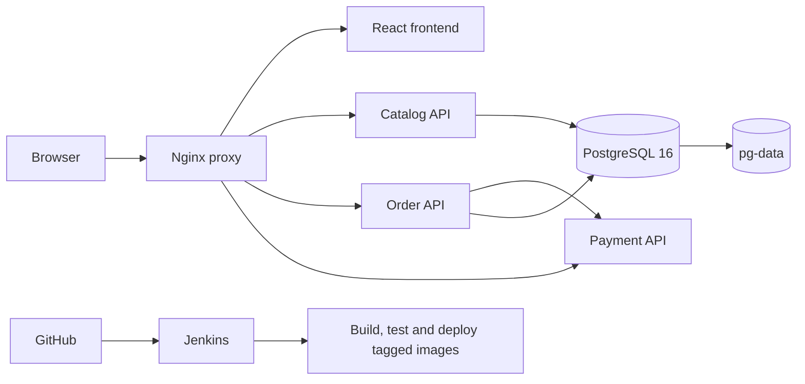

# QuickCart

Multi-container gift shop with React/Vite, PostgreSQL 16, Nginx and Jenkins.
The supplied QuickCart.pdf is the functional specification. See
[the implementation mapping](docs/PDF-IMPLEMENTATION.md) for the corresponding files.

## Start on a new laptop

Install Node.js 22.12 or newer and start Docker Desktop with Linux containers.
Extract this ZIP into an empty folder and open a terminal beside package.json:

```sh
npm install
npm run dev
```

Open the exact Local URL printed by Vite. It starts at localhost:8080 and chooses
the next available port when occupied. Keep the terminal and Docker engine running.
Each laptop has its own installation and database; no address or database password
needs copying from another laptop. First setup needs internet to fetch dependencies
and build images. Later starts reuse them. See [START-HERE.md](START-HERE.md).

## Docker architecture

| Service | Responsibility | Internal port |
|---|---|---|
| proxy | Single published application gateway | 8080 |
| frontend | Built React storefront served by Nginx | 8080 |
| catalog-api | Products, categories, suggestions, catalog migration | 3001 |
| order-api | Quotes, orders, stock, delivery and support | 3002 |
| payment-api | Simulated card, PayPal and Google Pay payments | 3003 |
| db | PostgreSQL 16, persistent pg-data volume | 5432 |

Only proxy publishes an application container port. Jenkins has a separate Compose
file and its own localhost:8081 port. Vite is the development entry point on the
laptop; npm start serves the application entirely through Docker's proxy URL.
APIs and PostgreSQL do not publish ports. Payment has no database access.

## Features

Product browsing, category filters, search suggestions, Holiday Deals, product
details, cart and live checkout quotes. Quotes apply PHP 300 off subtotals of
PHP 3,000 or more; standard shipping is free and express is PHP 149. Payments are
simulated. Orders and stock changes are transactional. My Account, delivery
tracking, support tickets and the backend reconnect screen remain available.
Recorded migrations run once and preserve their completion state across restarts.

## Jenkins and verification

Start Jenkins with npm run jenkins. Configure the repository/main branch and
the quickcart-env Secret file credential for this laptop. The application does
not require Jenkins to run locally. Jenkins runs Checkout, Test, Build Images,
Deploy and Smoke Test, triggered by Git polling or a configured webhook.
Images use the build number. Jenkinsfile.rollback redeploys a previous successful,
compatible image tag without deleting the database. See [the demo guide](docs/demo-runbook.md).

Useful commands: npm run doctor, npm run ps, npm run logs, npm run test:startup,
npm test, npm run setup:dev (explicit rebuild), npm stop (preserves data).
Keep .env in an existing installation: it identifies that installation's database.
Do not use docker compose down -v when keeping orders.

This package retains application features, all tests, Docker health checks and
Jenkins rollback. Superseded reports, presentations and version-specific notes
were removed; the supplied PDF itself was not edited.

## Architecture diagram



Proxy, frontend and APIs share frontend-net. Catalog, orders and PostgreSQL
share backend-net. Only the proxy publishes an application port; Jenkins runs
separately. See docker-compose.yml for the exact wiring.

## Team roles declared in the project PDF

| Member | Declared role |
|---|---|
| Cinense, Kyle Mathew T. | DevOps and Project Manager |
| Cuenco, John Gabrielle D. | Frontend Lead |
| Dayrit, Shaira Benneth M. | QA, Documentation and Presentation |
| Perez, Jan Andre T. | Backend Microservice Lead |
| Frayre, Angeline B. | Database and Orchestration Lead |

Declared roles are not a substitute for each member's actual commits and contribution evidence.
