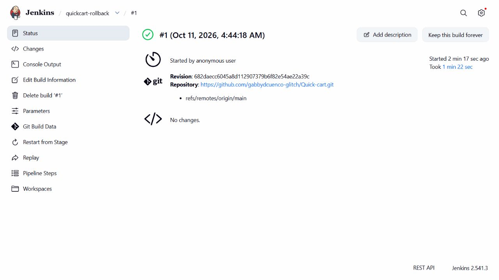
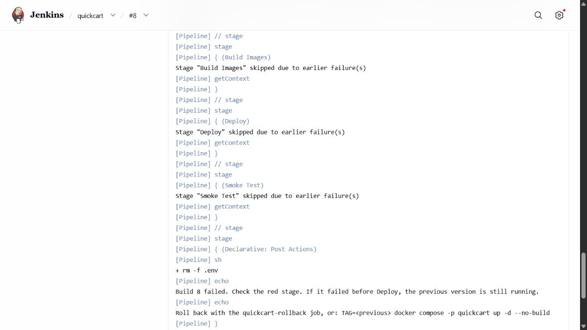
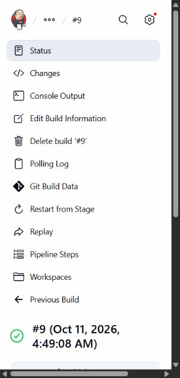

# Jenkins rollback and test-gate verification

Verified on 11 October 2026 against the local Docker engine and Jenkins connected to
https://github.com/gabbydcuenco-glitch/Quick-cart.

| Demonstration | Actual result | Jenkins record |
| --- | --- | --- |
| New version | Build 7 deployed successfully; its footer displayed Build 7. | [quickcart #7](http://localhost:8081/job/quickcart/7/) |
| Rollback | Rollback job 1 used ROLLBACK_TAG=6. All six running image tags changed from 7 to 6 without rebuilding. Smoke test passed. The old footer returned. | [quickcart-rollback #1](http://localhost:8081/job/quickcart-rollback/1/) |
| Failed-test gate | Build 8 deliberately failed one temporary Jest test. Build Images, Deploy and Smoke Test were skipped. All six deployed container IDs and image tags stayed unchanged. | [quickcart #8 console](http://localhost:8081/job/quickcart/8/console) |
| Recovery | The temporary failing test was reverted. Build 9 automatically ran from the GitHub change, passed every stage and deployed successfully. The footer displayed Build 9. | [quickcart #9](http://localhost:8081/job/quickcart/9/) |
| Data persistence | All 13 existing orders survived rollback, the failed build and recovery. A deterministic checksum of complete order rows was identical before and after each step. | Verified through PostgreSQL in the existing named volume. |

The intentional failure is recorded in commit `0377b83`; commit `0ea4fd2` removes it.
The failing test is absent from the current source and the updated portable ZIP.
Build 8 remains red as evidence of the successful gate demonstration; it is not an outstanding defect.

## Files included in the updated ZIP

The supplied QuickCart-Vite-v8.zip is retained as the base. Its application files,
dependencies, tests and documents are preserved. The verified Jenkins deployment
migration, deploy/rollback pipeline changes and visible build number are included.
This report and its screenshots record the demonstrations above.

The ZIP has package.json at its root. Extract it into a new empty folder, start Docker
Desktop, then run `npm install` and `npm run dev` in that folder. Use the Local URL
printed by Vite. Jenkins uses the separate Docker deployment; on the verified laptop
the application was at http://localhost:8082 and Jenkins at http://localhost:8081.

Jenkins history and Docker volumes stay on the laptop where the tests ran; they are
not embedded in a source ZIP. On a different laptop, the Docker services and Jenkins
jobs must be initialized there. Database data and local .env files are not distributed.

## Repeating the demonstrations

1. Keep two compatible successful build tags on the same Docker engine.
2. Open quickcart-rollback, choose Build with Parameters, and enter the previous
   successful build number as ROLLBACK_TAG. Verify success, running tags and orders.
3. Commit a temporary failing Jest test and push. Wait for SCM polling to trigger
   quickcart. Verify failure in Test, skipped Deploy and an unchanged running version.
4. Revert the temporary test, push, and wait for a successful deployment before ending
   the demonstration. Do not run rollback and deployment jobs concurrently.

Rollback was verified for compatible builds 7 and 6. This result does not establish
that an arbitrary older image is compatible with a future database schema.
